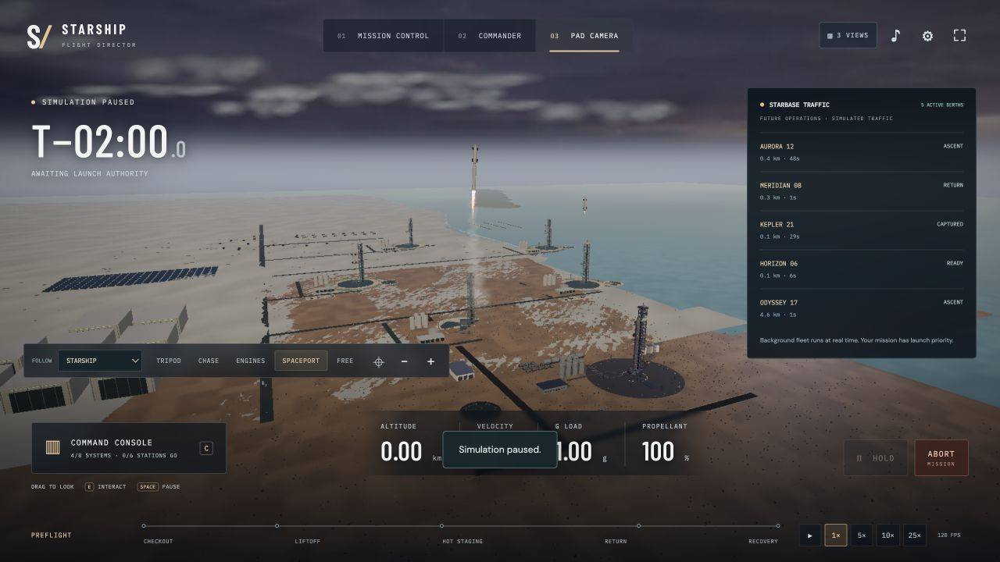
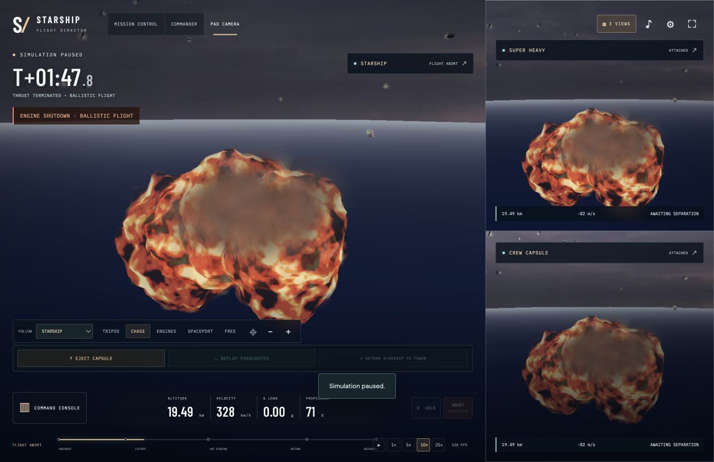

# Starship · Flight Director

**Three vehicles. One mission. A spaceport to explore.**

A browser-based 3D launch simulator that puts you in mission control, a conceptual crew cockpit, or a camera overlooking the launch complex. Run the countdown, follow staging and recovery, and respond to failures while every view shares the same live mission.

[**Play the live demo**](https://starship-flight-director-hanlien.greentazn.chatgpt.site/) · [Portfolio](https://8xgreen.com/) · [Flight manual](docs/FLIGHT-MANUAL.md)



## Explore the mission

- **Direct the launch.** Complete system checks and station votes; configure payload, fuel, throttle, and guidance; hold or abort when conditions change.
- **Follow all three vehicles.** Track Starship, the booster, and the training capsule through simultaneous cameras, chase views, engine inspection, and a free camera.
- **Rehearse recovery.** Watch independent booster descent, a conceptual ship tower catch, and a fictional capsule escape with manually commanded parachutes.
- **Respond to failures.** Inject training faults and see incident-driven fireballs, debris, smoke, shockwaves, and layered explosion audio.
- **Visit an active spaceport.** Explore five fictional operating sites with scheduled departures, arrivals, and a live traffic board.
- **Hear the mission.** An original procedural score, vehicle-aware engine sound, radio captions, and browser speech accompany each phase.



## Run locally

Download or clone this repository, then run the following from its root with Python 3:

```sh
python3 -m http.server 8080 --bind 127.0.0.1 --directory dist
```

Open [localhost:8080](http://127.0.0.1:8080/). Choose **Quick launch** for a prepared mission or **Explore the spaceport** to look around. Press `Ctrl+C` in the terminal to stop the server.

There is no dependency install or build step. The app, renderer, fonts, and visual assets are bundled in `dist/`; any static HTTP server can serve that folder. Use HTTP rather than opening `index.html` directly so textures load reliably.

A desktop browser with WebGL and hardware acceleration is recommended. **Balanced** graphics and adaptive resolution are enabled by default. Audio begins after interaction; narration voice availability varies by browser and operating system.

## Controls

| Input | Action |
| --- | --- |
| `1` / `2` / `3` | Mission control / commander / pad camera |
| `C` | Open or close the command console |
| `S` or **3 VIEWS** | Toggle simultaneous vehicle views |
| Drag; click or `E` | Look around; interact with a physical control |
| `Space` / `H` | Pause the simulation / hold or resume the countdown |
| `P` | Arm the capsule parachutes after separation |
| `M` / `F` | Toggle audio / fullscreen |
| `Esc` | Close the console or open/close the pause menu |
| `W A S D`, `Q` / `R`, `Shift` | In **FREE** camera: move, descend/ascend, move faster |

In the free camera, `S` moves backward; use the **3 VIEWS** button to switch views. The [flight manual](docs/FLIGHT-MANUAL.md) covers checkout, training faults, escape, and recovery in detail.

## Built with

Plain JavaScript, HTML, and CSS; Three.js/WebGL for rendering; the Web Audio API for procedural sound; and the browser's speech synthesis for narration. Python serves the local files, and Node.js runs the regression checks. No application server or player account is required: each browser runs its own independent mission.

| File | Responsibility |
| --- | --- |
| `dist/simulation.js` | Flight state, physics, commands, recovery, and failure incidents |
| `dist/game.js` | Interface, input, mission orchestration, and the animation loop |
| `dist/scene.js` | Shared 3D world, vehicle presentation, and camera views |
| `dist/rendering.js`, `dist/interiors.js` | Rendering setup and conceptual interior environments |
| `dist/spaceport.js` | Background traffic and spaceport activity |
| `dist/failure-fx.js` | Pooled cinematic fire, smoke, debris, and shockwaves |
| `dist/audio.js` | Procedural score, environmental sound, explosions, and speech queue |
| `dist/index.html`, `dist/game.css` | Interface structure and styling |

## Checks

With Node.js available, run from the repository root:

```sh
node tests/physics.cjs
node tests/audio.cjs
node tests/failure-fx.cjs
```

These cover flight and command behavior, audio lifecycle, and failure-effect state/resource handling. Visual quality and device performance still require browser testing.

## Simulation scope and credits

This is an independent, fan-made educational simulation, unaffiliated with SpaceX. The crew capsule, cockpit, spaceport operations, and combined booster/ship recovery scenario are fictional or conceptual. The simplified flight model is not validated against real flight telemetry; cinematic failures do not calculate physical blast damage.

- [Flight manual](docs/FLIGHT-MANUAL.md) — mission flow and controls.
- [Model notes](docs/MODEL-NOTES.md) — assumptions, references, and simulation boundaries.
- [Performance notes](docs/PERFORMANCE.md) — rendering design, asset budgets, and measurement limits.
- [Third-party notices](THIRD-PARTY-NOTICES.md) — bundled library, font, and visual-asset credits and licenses, including Three.js, Poly Haven, and Solar System Scope.
